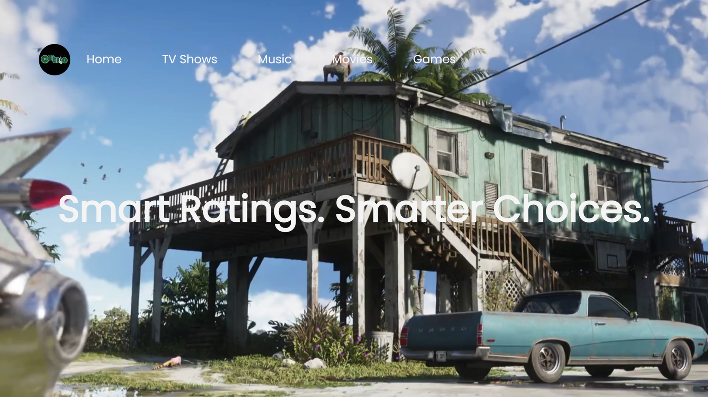
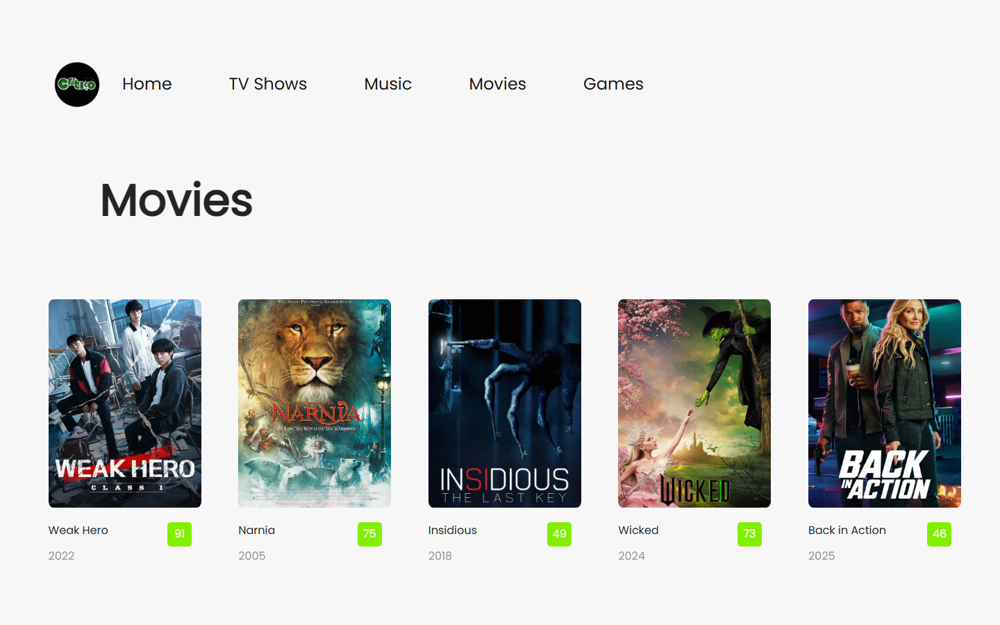
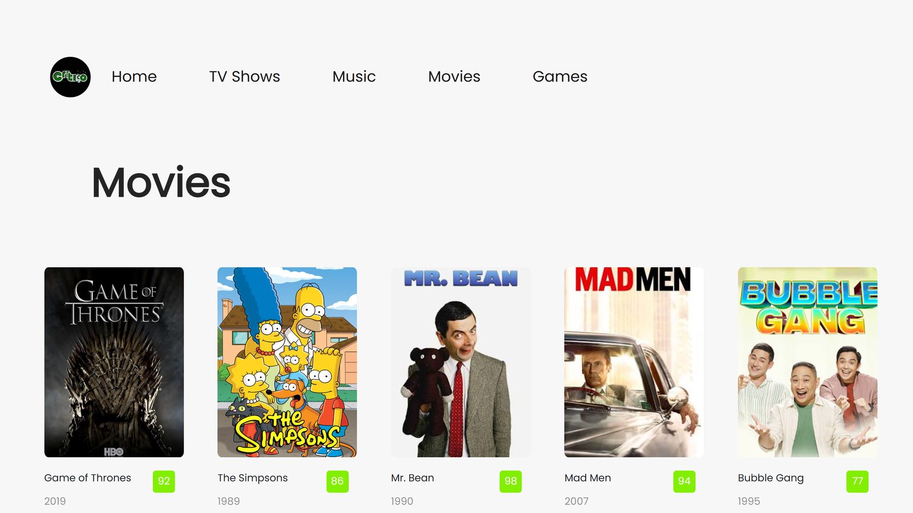
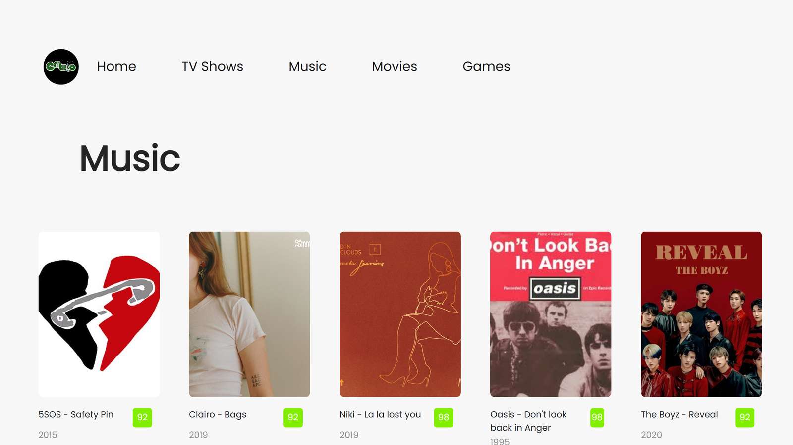
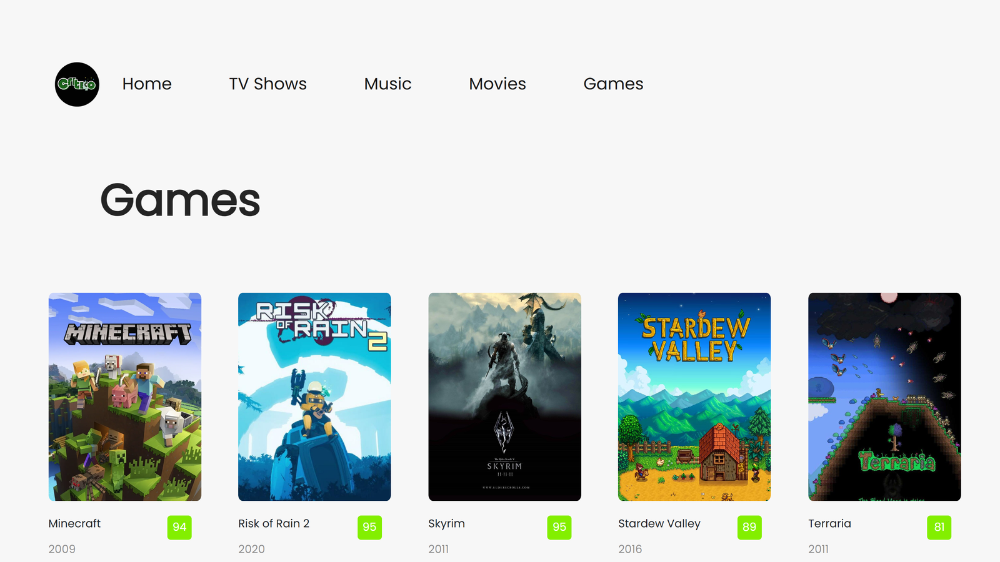

# Critiqo

**An entertainment review website for movies, TV shows, music and games.**

Critiqo brings reviews for different kinds of entertainment into one place. Each title has its own page with an embedded trailer or music video, key details, cast and community reviews. The site is responsive and works on desktop, tablet and mobile screens.


---

## Screenshots



<table>
  <tr>
    <td width="50%"><br><sub>Movies page with posters and ratings</sub></td>
    <td width="50%"><br><sub>TV Shows page</sub></td>
  </tr>
  <tr>
    <td width="50%"><br><sub>Music page with album covers and ratings</sub></td>
    <td width="50%"><br><sub>Games page</sub></td>
  </tr>
</table>

## Features

- **Four categories:** TV Shows, Music, Movies and Games, each with its own page
- **20 review pages:** five titles per category, each with an embedded YouTube trailer or music video, release details, cast and reviews
- **Homepage:** full-width video banner, top-rated picks from every category and an About Us section
- **Responsive layout:** a collapsible Bootstrap navigation bar and layouts that adapt to the screen size
- **Consistent navigation:** shared header and footer on every page, with a "Back to Top" link

## My Role

I worked on this team project as the **Front-End Developer** and led the team as **Project Manager**.

- Built a responsive multi-page review site for movies, games, TV shows, and music.
- Designed layouts with Bootstrap's grid and components, ensuring the site works smoothly on mobile and desktop.
- Embedded trailers and media, and organized content into ratings, reviews, and trending lists.

## Tech Stack

| Area | Technology |
|---|---|
| Markup | HTML5 |
| Styling | CSS3, Bootstrap 5.3 |
| Media | YouTube embeds |

No frameworks, build tools or back end are required.

## Project Structure

```
Critiqo/
├── index.html              # Homepage
├── style.css               # Homepage styles
├── css-files/
│   ├── subpage-style.css       # Category page styles
│   └── inner-subpage-style.css # Review page styles
├── html-files/
│   ├── tvshowspage.html    # Category pages
│   ├── musicpage.html
│   ├── moviepage.html
│   ├── gamespage.html
│   ├── tvshows/            # Review pages (5 per category)
│   ├── music/
│   ├── movies/
│   └── games/
└── assets/                 # Images, icons and the homepage banner
```

## Getting Started

The site is static, so it runs directly in the browser.

```bash
git clone https://github.com/yeldsg/critiqo.git
cd critiqo
```

Then open `index.html` in any modern browser. An internet connection is needed for Bootstrap and the embedded videos.

## About This Project

Critiqo was built as a team project for a web development course (April – May 2025).

## Credits

Videos are embedded from their official YouTube channels. All titles, posters, artwork and videos belong to their respective owners and are used for educational purposes only.

## Author

**Kathrina Marhiel Zamora** · BS Information Technology, Pampanga State University
GitHub: [@yeldsg](https://github.com/yeldsg) · Portfolio: [yeldsg-portfolio.vercel.app](https://yeldsg-portfolio.vercel.app) · LinkedIn: [linkedin.com/in/yeldsg](https://www.linkedin.com/in/yeldsg)
